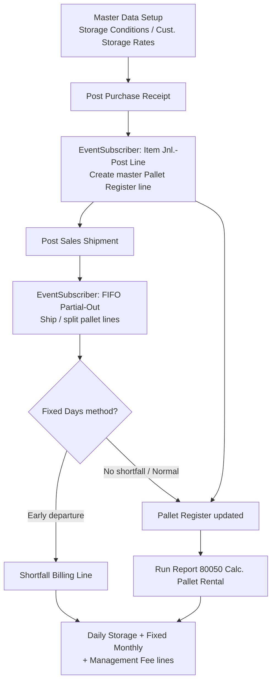
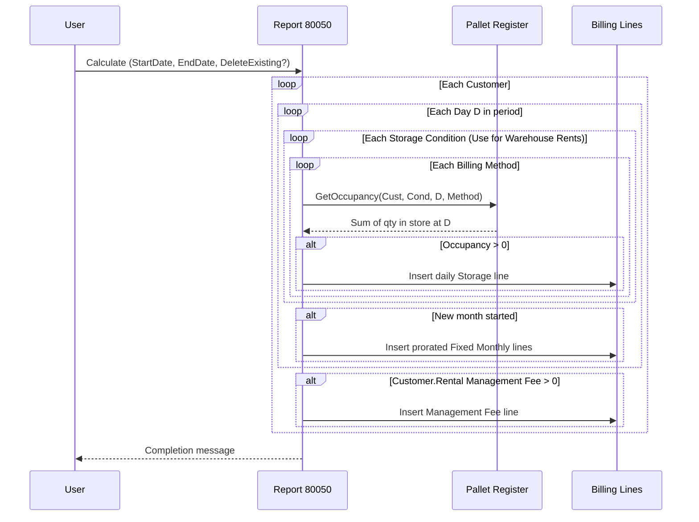

# SubzeroPalletRental – Process Flow

**Purpose**: Automated pallet-rental tracking & billing for a 3PL cold-store. Pallets in/out are captured automatically from posted warehouse documents, and a periodic billing engine generates daily storage, monthly fixed, management-fee, and shortfall charges.

---

## End-to-End Overview

```
Setup Rates ─┐
PO Posting ──┼─> Pallet Register (master/partial lines) ──> Calc. Pallet Rental (80050)
SO Posting ──┘         │  auto in/out events                     │
                       └─> Shortfall Billing Lines (at ship) ────┴─> Pallet Rental Billing Lines
                                                                     (daily/monthly/mgmt fee)
```



---

## 0. Master Data Foundation

| Object | Role |
|---|---|
| `Pallet Rental Setup` (80020) | Toggles (`Auto Create Pallets on Rcpt`, `Auto Ship Pallets on Shipment`), ID separator, `Fixed Charge Base Days` (default 30), `Charge Same-Day In/Out` |
| `Storage Condition` (80024) | Ambient / Frozen / Chilled + default `Rent Pallet/Day`, flag `Use for Warehouse Rents` |
| `Cust. Storage Rate` (80023) | Matrix **Customer x Condition**: rate override, `Allocated Locations` (reserved block), `Fixed Monthly Charge` |
| Item ext. (80006) | Owner `Customer Code`, `Storage Condition Code`, `Rent Pallet/Day`, `Qty. per Pallet (Base)` |
| Customer ext. (80002) | Default `Pallet Billing Method`, `Minimum Storage Days`, `Rental Management Fee` |
| Purchase Header ext. (80026) | `Pallet Billing Method` + `Minimum Storage Days` -> **scenario decided at receiving** |
| Sales Header ext. (80025) | Per-order overrides incl. `DO Per-Day Rate` |

Billing methods (Enum 80020 `Pallet Rental Billing Method`):

- **Normal Counting** - charge actual daily occupancy.
- **Fixed Locations** - reserved block covered by flat monthly charge; excess charged per day.
- **Fixed Days** - minimum chargeable period; lump-sum shortfall if the pallet leaves earlier.

Pallet status (Enum 80021): **In Store**, **Shipped**.

---

## 1. Receiving (Inbound PO)

Trigger: posting a purchase receipt -> `Item Jnl.-Post Line :: OnAfterInsertItemLedgEntry` (codeunit 80020).

```
Post Purchase Receipt
   └─> EventSubscriber CreatePalletsOnPurchaseReceipt
         ├─ Guards: Setup ON + EntryType=Purchase + DocType=Purchase Receipt
         │           + Lot No. <> '' + Qty > 0
         └─> CreatePalletForEntry()
               ├─ Pallet ID = <Item No.><sep><Lot No.>        (master line, Line 10000)
               ├─ Owner customer: Item."Customer Code" -> fallback ILE Source No.
               ├─ Scenario: PO header (Method + Min Days) -> fallback Customer defaults
               ├─ Rate: Cust. Storage Rate override -> else Item/Condition rate
               └─ INSERT "Pallet Register" master line: whole lot qty,
                  Status = In Store, Received Date, PO No., Receipt Entry No.
```

Key rules:

- ONE master line per LOT holding the whole received quantity.
- Pallet ID is unique because every receipt carries a different lot number.
- PO resolution goes through the posted receipt header (`Purch. Rcpt. Header."Order No."`) while the order still exists during posting.

## 2. Shipping (Outbound Sales Shipment - FIFO Partial-Out)

Trigger: posting a sales shipment -> same event subscriber.

```
Post Sales Shipment
   └─> EventSubscriber ShipPalletsOnSalesShipment  (QtyToShip = -ILE.Quantity)
         ├─ Guards: Setup ON + EntryType=Sale + DocType=Sales Shipment + Lot No. <> ''
         └─> ShipPalletsForEntry()
               └─ FIFO loop over In-Store MASTER lines of same Item+Lot:
                     ├─ Full remainder ships -> MarkShipped()
                     │     (Status=Shipped, Shipped Date, Shipment Doc No.)
                     └─ Partial -> reduce master qty + INSERT extra
                           "Is Partial Out" line (same Pallet ID, next Line No.,
                           Status=Shipped)     <- one pallet can leave in many partials
               └─ every departure -> CreateShortfallIfAny()
```

Key rules:

- Only master lines are counted for occupancy; partial-out lines carry shipped quantities.
- A pallet may ship in several partials over different days.

## 3. Fixed-Days Shortfall (at each departure)

Only when the pallet's method = **Fixed Days** and `Minimum Storage Days` > 0:

```
DaysInStore    = ShipDate - ReceivedDate + 1        (inclusive)
ShortfallDays  = MinStorageDays - DaysInStore
if ShortfallDays > 0 -> Billing Line:
      Charge Amount = Rate x ShortfallDays x DepartQty
      Charge Type = Shortfall, linked to Source Pallet ID
```

## 4. Periodic Billing Run - Report 80050 `Calc. Pallet Rental` (ProcessingOnly)

Entry point: **Pallet Rental Billing Lines** page -> *Calculate* action (runs report).

```
For each Customer (request-page filtered):
   For D = StartDate .. EndDate:                        <- day-by-day loop
      For each Storage Condition where Use for Warehouse Rents:
         For each Billing Method (Normal / Fixed Location / Fixed Days):
            Occupancy = SUM of pallet quantities IN STORE at end of day D
                        (master lines not yet shipped; partial-out lines
                         counted until their Shipped Date; optional
                         same-day in/out add-back per Setup)
            if Occupancy > 0 -> INSERT daily "Storage" Billing Line
               Rate      = Cust. Storage Rate ?? Condition rate
               Chargeable= Occupancy - Allocated Locations   (Fixed Location only, min 0)
               Amount    = Chargeable x Rate
            [optional] delete prior Storage lines for that Cust/Condition/Day
      If month changed -> INSERT prorated "Fixed Monthly" lines:
               Fixed Monthly Charge x DaysInMonth / BaseDays (per condition w/ charge <> 0)
   After period -> INSERT single "Management Fee" line (if Customer.Rental Management Fee > 0)
```

Output lands in **Pallet Rental Billing Lines** (table 80022) for review; invoice creation is outside this codebase.

### Billing Sequence Diagram



---

## Object Inventory

| Type | ID | Name | Active |
|---|---|---|---|
| Codeunit | 80020 | Pallet Rental Mgt. | Yes |
| Table | 80020 | Pallet Rental Setup | Yes |
| Table | 80021 | Pallet Register | Yes |
| Table | 80022 | Pallet Rental Billing Line | Yes |
| Table | 80023 | Cust. Storage Rate | Yes |
| Table | 80024 | Storage Condition | Yes |
| Page | 80020 | Pallet Rental Setup | Yes |
| Page | 80021 | Pallet Register List | Yes |
| Page | 80022 | Pallet Rental Billing Lines | Yes |
| Page | 80023 | Pallet Register Card | Yes |
| Page | 80024 | Cust. Storage Rates | Yes |
| Page | 80025 | Storage Condition | Yes |
| Report | 80050 | Calc. Pallet Rental | Yes |
| Reports | 80045/80047/80048/80049 | Legacy v1 stock/accounting reports | Commented out (reference only) |
| TableExts | 80002/80006/80025/80026 | Customer / Item / Sales Header / Purchase Header | Yes |
| PageExts | 80008/80027/80028/80077 | Item Card / Purchase Order / Sales Order / Customer Card | Field exposure |

---

## Observations / Known Risks

1. **Backup files inside app folders** (`Cod80020.PalletRentalMgt copy*.al`, `Rep80050...copy*.al`) - duplicate object IDs will break compilation unless fully commented out or excluded from the project.
2. **Legacy reports entirely commented out** (80045/80047/80048/80049) - dead weight kept for reference.
3. **Performance**: `GetOccupancy` rescans all pallet rows per day x condition x method - acceptable for small volumes, degrades on long periods / many pallets.
4. **Concurrency**: `NextEntryNo` seeding via `FindLast()` can collide under parallel runs.
5. **No invoicing step**: billing lines are informational; no automatic Sales Invoice conversion exists yet in this extension.
